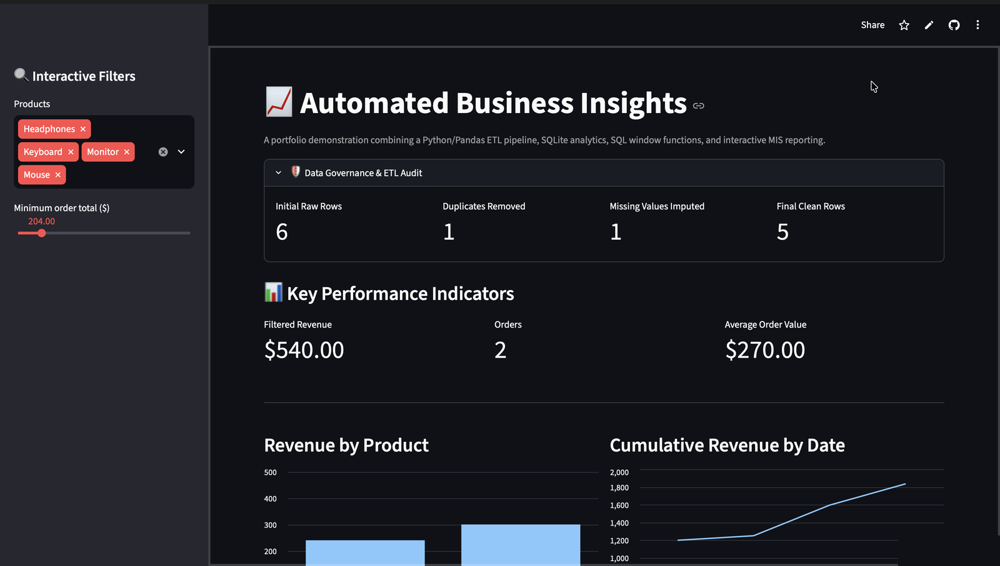
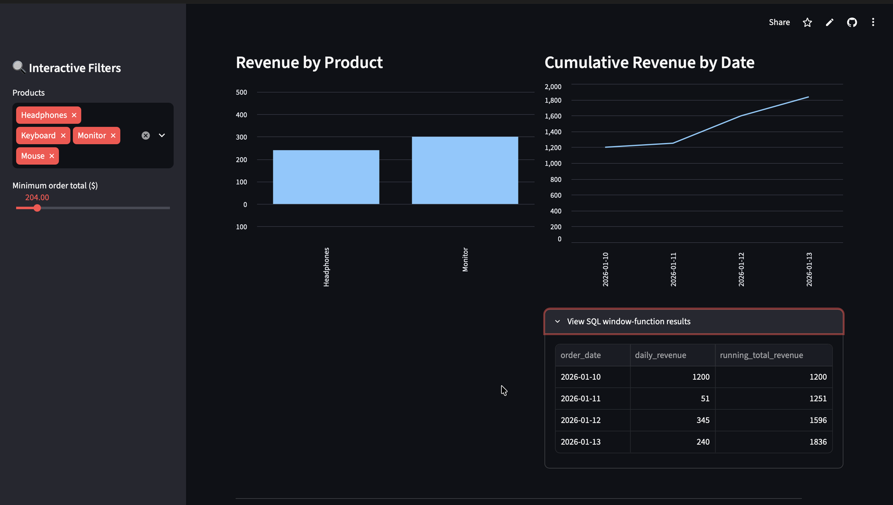
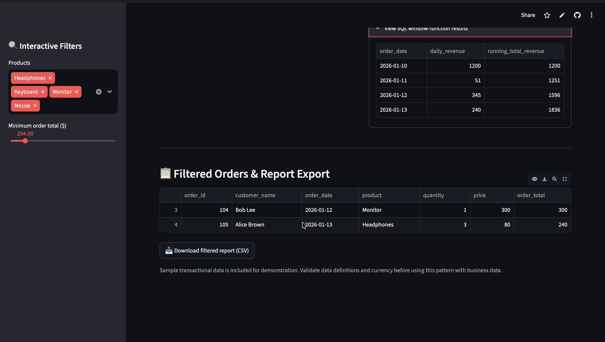

# Automated Business Insights — SQL & Python ETL Pipeline

An end-to-end MIS reporting pipeline that turns a messy sales export into validated records in SQLite, answers business questions with SQL window functions, and serves the results through an interactive management dashboard.

## Live Demo

[**Open the live dashboard**](https://automated-business-insights-sql-python-etl-pipeline-gbmd5xnvq7.streamlit.app/) — deployed on Streamlit Community Cloud, running directly from this repository. The app builds its own SQLite database on first load, so no data file is committed.

## Dashboard Preview

<p align="center">
  
</p>

<p align="center"><strong>Sidebar filters applied — four products and a 204.00 minimum order value. The audit panel reports the full pipeline load; every KPI, chart and table below recalculates from the active filter.</strong></p>

<p align="center">
  
</p>

<p align="center"><strong>Revenue by product, and the running cumulative revenue calculated by the SQL window function, with the query output expanded</strong></p>

<p align="center">
  
</p>

<p align="center"><strong>Order-level detail for the current selection, with the one-click CSV export</strong></p>

## Business Problem

Operational sales exports arrive messy: the same order logged twice, customer names missing or typed in different cases, and dates written in three different formats depending on who exported them. Every one of those defects distorts a report. A duplicate inflates revenue and order counts; a blank customer name quietly disappears from a query that filters on it; an unparsed date breaks any time-series view.

The stakeholder is a MIS / reporting analyst and the sales operations manager who reads their output. The decision this supports is which products actually carry revenue, where order value concentrates, and whether the numbers in the monthly report can be trusted at all — the last of which is the question that usually goes unanswered.

## Dataset

The repository ships a small synthetic dataset in `raw_data.csv` so the pipeline runs without any external dependency.

| Column | Meaning |
|---|---|
| `order_id` | Identifier for the order |
| `customer_name` | Name of the customer who placed it |
| `order_date` | Date of the order |
| `product` | Product purchased |
| `quantity` | Units ordered |
| `price` | Unit price |

Six raw rows are included, and four realistic defects were deliberately injected into them:

- **A duplicate row** — order `102` appears twice, so a naive `SUM` would overstate revenue.
- **A blank customer name** — order `103` has no name at all.
- **Three date formats** — `2026-01-10`, `2026/01/11` and `01-13-2026` all appear in the same column.
- **Inconsistent casing** — `mary johnson` arrives lowercase.

The dataset is intentionally small and synthetic. It exists to demonstrate the workflow, not to represent real trading performance.

## How It Works

```text
raw_data.csv
    │
    ▼
Extract + validate schema ──── missing columns raise an error
    │
    ▼
Clean (Pandas)
    ├── drop_duplicates()
    ├── whitespace strip → blank treated as null → fillna("Unknown") → str.title()
    ├── pd.to_datetime(format="mixed", errors="coerce") → ISO YYYY-MM-DD
    └── to_numeric() on quantity and price
    │
    ▼
Audit row (row counts, defects found, status, UTC timestamp)
    │
    ▼
SQLite via SQLAlchemy — cleaned_orders + etl_audit_log
    │
    ▼
SQL analytics (CTEs, RANK, ROW_NUMBER, running SUM OVER)
    │
    ▼
Streamlit dashboard ──► filtered CSV export
```

### Stage 1 — Extraction and schema validation

`etl_pipeline.py` reads `raw_data.csv` and checks it against a `REQUIRED_COLUMNS` set before doing anything else. If a column is missing, the pipeline stops with a clear message naming it, rather than failing later inside a chart. A missing input file raises `FileNotFoundError` with the filename in the message.

### Stage 2 — Cleaning

Each transformation targets one of the injected defects:

- `drop_duplicates()` removes the duplicated order before any aggregation happens.
- Customer names are stripped of whitespace, blank strings are converted to null with `.mask()`, then filled with `"Unknown"` and title-cased with `.str.title()`. Stripping first matters: `"   "` is not `NaN`, so a plain `fillna()` would leave a whitespace-only name in place.
- `pd.to_datetime(..., format="mixed", errors="coerce")` parses the three date formats in one pass and rewrites them to ISO `YYYY-MM-DD`. `format="mixed"` is what stops Pandas from silently converting valid dates to `NaT` when the column is inconsistent.
- `quantity` and `price` are coerced with `to_numeric(..., errors="coerce")` so a stray text value becomes null instead of breaking the arithmetic downstream.

### Stage 3 — Audit logging

Every run writes one row to an `etl_audit_log` table recording `initial_rows`, `duplicates_removed`, `missing_values_imputed`, `invalid_dates`, `invalid_sales_rows`, `final_clean_rows`, an `etl_status` of `SUCCESS`, and a UTC `processed_at_utc` timestamp.

This is the part that makes the project a governance exercise rather than a cleaning script: the dashboard reads that row and shows the reader how much the data was altered before it reached them. On this sample dataset `invalid_dates` and `invalid_sales_rows` both return zero — the checks are defensive guards that the bundled data never triggers, which is worth stating plainly rather than implying they caught anything.

### Stage 4 — Loading

Both tables are written through a single SQLAlchemy engine inside one `engine.begin()` transaction, so the load either completes fully or not at all. The connection is released in a `finally` block.

### Stage 5 — SQL analytics

`sql_analytics.py` runs four queries and prints each result set. It refuses to run with a helpful message if the database or the `cleaned_orders` table is missing.

| # | Business question | Technique | Result on the sample data |
|---|---|---|---|
| 1 | How does revenue accumulate over time? | CTE + `SUM() OVER (ROWS BETWEEN UNBOUNDED PRECEDING AND CURRENT ROW)` | 1,200 → 1,251 → 1,596 → 1,836 |
| 2 | How do products rank by revenue? | CTE + `RANK() OVER (ORDER BY total_revenue DESC)` | Laptop 1,200 (1), Monitor 300 (2), Headphones 240 (3), Mouse 51 (4), Keyboard 45 (5) |
| 3 | What is the highest-value order for each product? | `ROW_NUMBER() OVER (PARTITION BY product …)` | One row per product, including order 102 at 51.00 and the imputed `Unknown` customer |
| 4 | Which orders clear a high-value threshold? | `WHERE quantity * price > 100` | Orders 101 (1,200.00), 104 (300.00), 105 (240.00) |

Query 3 is the one worth reading closely: `ROW_NUMBER()` partitioned by product returns exactly one order per product regardless of ties, which is the pattern used for "top N per group" reporting where `RANK()` would return duplicates.

### Stage 6 — Dashboard

`app.py` renders the whole reporting layer in Streamlit:

- **MIS Data Governance & ETL Audit Log** — the four headline audit metrics as cards, with the invalid-date and invalid-row counts beneath them.
- **Sidebar filters** — a product multi-select and a minimum-order-total slider. If every order happens to have the same total, the slider is replaced by a caption instead of a broken zero-width control.
- **KPI cards** — filtered revenue, order count and average order value, all recomputed from the current filter state.
- **Revenue contribution by product** — a bar chart for comparative performance.
- **Running cumulative revenue** — a line chart, with the underlying SQL window-function output available in an expander so the reader can see the query result rather than only its chart.
- **Filtered orders table** — order-level detail for the rows matching the filters.
- **CSV export** — downloads the currently filtered set, so the dashboard output can go straight into a management report.

The dashboard also initialises itself. On first launch, if `business.db` is missing or lacks the expected tables, `app.py` runs the ETL through `subprocess` and then loads normally. If that subprocess fails, the error output is shown in an expander instead of a blank page. This means a fresh clone works with one command and no manual pipeline step.

## Results on the Sample Dataset

| Data-quality / reporting measure | Result |
|---|---:|
| Raw rows read | 6 |
| Duplicate rows removed | 1 |
| Missing customer names imputed | 1 |
| Invalid dates coerced | 0 |
| Rows with invalid quantity or price | 0 |
| Cleaned rows loaded | 5 |
| Total revenue | 1,836.00 |
| Orders | 5 |
| Average order value | 367.20 |

These are outputs from the bundled demonstration data, not real company performance results. The dashboard screenshots above show a filtered slice (four products, 204.00 minimum order value), which is why their KPI cards read 540.00 and 2 orders rather than the full totals in this table.

## Repository Structure

| File | Purpose |
|---|---|
| `raw_data.csv` | Synthetic source data with four injected defects |
| `etl_pipeline.py` | Extraction, validation, cleaning, audit logging and load to SQLite |
| `sql_analytics.py` | Four SQL analyses covering CTEs, ranking and window functions |
| `app.py` | Streamlit dashboard, self-initialising, with filtered CSV export |
| `requirements.txt` | Python dependencies |
| `.github/workflows/dashboard-preview.yml` | CI job that runs the pipeline and refreshes the dashboard screenshot |
| `screenshots/` | Dashboard images used in this README |
| `.gitignore` | Excludes virtual environments, local databases and editor files |

## Run Locally

### 1. Clone the repository

```bash
git clone https://github.com/rishibhor326-lgt/Automated-Business-Insights-SQL-Python-ETL-Pipeline.git
cd Automated-Business-Insights-SQL-Python-ETL-Pipeline
```

### 2. Create and activate a virtual environment

**macOS / Linux**

```bash
python3 -m venv .venv
source .venv/bin/activate
```

**Windows PowerShell**

```powershell
python -m venv .venv
.venv\Scripts\Activate.ps1
```

### 3. Install dependencies and run the pipeline

```bash
python -m pip install -r requirements.txt
python etl_pipeline.py
python sql_analytics.py
streamlit run app.py
```

`python etl_pipeline.py` prints the audit summary to the terminal. `python sql_analytics.py` prints all four result sets. `streamlit run app.py` opens the dashboard, usually at `http://localhost:8501`.

## Continuous Integration

`.github/workflows/dashboard-preview.yml` runs on every push to `main` and on manual dispatch. It installs the dependencies, executes the ETL pipeline and the SQL analytics, starts Streamlit in headless mode, waits for its health endpoint to respond, and captures a fresh screenshot of the dashboard with Playwright before committing it back to the repository.

The practical effect is that the pipeline is exercised on every push — a change that breaks the ETL, the SQL or the dashboard fails the workflow — and the README screenshot cannot drift out of date from the code.

## Design Decisions

**SQLite over a server database.** A file-based database means a reviewer can clone the repository and run it without provisioning anything. The SQL is standard, so migrating to PostgreSQL or MySQL is a connection-string change plus a review of the load strategy, not a rewrite.

**Pandas for transformation, SQL for analysis.** Cleaning is expressed in Pandas because null handling, type coercion and mixed-format dates are far clearer there than in SQL. The analytical layer is deliberately written in SQL so the logic lives in the database and stays portable to a real warehouse.

**Full refresh rather than incremental load.** `if_exists="replace"` keeps the pipeline idempotent and simple: running it twice produces the same database. It is the correct choice for a demonstration and the wrong one for a growing table, which is why incremental loading is the first item under future improvements.

**An audit table, not a log file.** Writing the audit row into the same database as the cleaned data lets the dashboard read and display it. A log file would be invisible to the person consuming the report — the exact problem the table solves.

**Streamlit for the interface.** The reporting layer is a few hundred lines of Python with no separate frontend, so the whole project stays in one language and one repository.

## Limitations

- **The dataset is tiny.** Six rows is enough to prove the pipeline works and far too small to say anything meaningful about product performance. The results table above describes the demonstration data only.
- **Single currency.** All values are treated as US dollars with no currency column, conversion or rounding policy.
- **Full-refresh loading only.** No incremental or upsert logic, no watermark tracking, and no primary-key enforcement on `cleaned_orders`.
- **No production scheduler.** The pipeline runs on demand locally and is validated by CI on push; it is not orchestrated on a schedule.
- **No test suite.** The transformations are exercised by the CI run, but there are no unit tests asserting the cleaning rules.
- **No authentication.** The dashboard is public and read-only; there is no access control or row-level security.
- **Validation guards are untested by the data.** The invalid-date and invalid-quantity checks return zero on the bundled sample, so they have not been proven against a genuinely dirty input.

## Future Improvements

1. Incremental loading with a watermark or upsert on `order_id`, replacing the full refresh.
2. A pytest suite covering each cleaning rule, including whitespace-only names and unparseable dates.
3. Migration to PostgreSQL with connection pooling, plus indexes on `order_date` and `product`.
4. Scheduled orchestration — Airflow, Prefect or a simple cron — with failure alerting.
5. Data-quality assertions via Great Expectations or Pandera, wired into the CI workflow.
6. A larger, more realistic dataset so the product and cohort views carry analytical weight.

## Skills Demonstrated

- Programmatic data cleaning in Pandas: `drop_duplicates`, null masking and imputation, `str.title`, `to_numeric`, and `pd.to_datetime` with `format="mixed"`.
- Relational loading with SQLAlchemy into SQLite, using transactional writes and explicit connection cleanup.
- Advanced SQL: common table expressions, `RANK()`, `ROW_NUMBER() PARTITION BY`, and a running total via `SUM() OVER (ROWS BETWEEN UNBOUNDED PRECEDING AND CURRENT ROW)`.
- Data governance: capturing pipeline audit metrics and surfacing them to the report reader.
- BI delivery in Streamlit: KPI cards, sidebar filters, charts, drill-down tables and CSV export.
- CI automation with GitHub Actions and Playwright, including headless app health checks and screenshot capture.

## Author

**Rishi Bhor**

[GitHub](https://github.com/rishibhor326-lgt/) · [LinkedIn](https://www.linkedin.com/in/rishi-bhor-02a23b289/)
