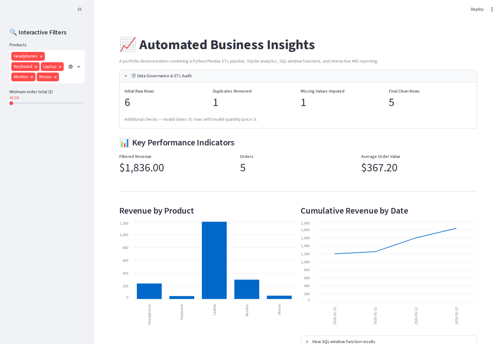
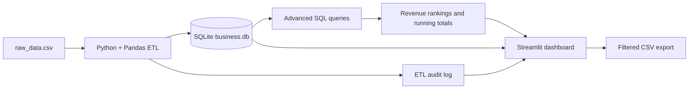

# Automated Business Insights & SQL/Python ETL Pipeline

A portfolio project demonstrating an end-to-end analytics workflow: raw CSV ingestion, data cleaning and audit logging with Python/Pandas, relational storage with SQLite and SQLAlchemy, advanced SQL analytics, and an interactive Streamlit MIS dashboard.

[](https://www.python.org/)
[](https://pandas.pydata.org/)
[](https://www.sqlalchemy.org/)
[](https://www.sqlite.org/)
[](https://streamlit.io/)

> **Live demo status:** A public Streamlit app URL has not been configured yet. Use the deployment link below to publish this repository from your Streamlit Community Cloud account; that flow creates the actual public app URL.

[](https://share.streamlit.io/deploy?repository=rishibhor326-lgt%2FAutomated-Business-Insights-SQL-Python-ETL-Pipeline&branch=main&mainModule=app.py)

## Dashboard screenshot

The workflow captures a screenshot of the running Streamlit application and stores it at `screenshots/dashboard.png`.



## Project overview

The project is inspired by the **WsCube Tech 15 Data Analyst Projects** suite and its YouTube video, [“Build these 15 real-world Data Analyst projects and make your resume stand out!”](https://www.youtube.com/watch?v=pgogccDP8jw). The implementation in this repository is a portfolio exercise using the sample data committed here.

### What it does

**1. Python/Pandas ETL — `etl_pipeline.py`**
- Reads `raw_data.csv` and checks that required columns are present.
- Removes exact duplicate rows.
- Fills missing or whitespace-only customer names with `Unknown`, then standardizes names to title case.
- Parses mixed date formats into ISO `YYYY-MM-DD` dates and records invalid dates.
- Validates numeric quantity and price fields.
- Loads the cleaned rows and a data-quality audit record into `business.db`, with tables `cleaned_orders` and `etl_audit_log`.

**2. Advanced SQL analytics — `sql_analytics.py`**
- Uses CTEs to make analysis queries easier to read.
- Uses `SUM() OVER` for cumulative revenue, `RANK()` for product revenue ranking, and `ROW_NUMBER()` to select the highest-value order per product.
- Identifies transactions with an order total greater than $100.

**3. Streamlit MIS dashboard — `app.py`**
- Creates the SQLite database from the included CSV on first launch if the expected tables are missing.
- Shows data-quality audit metrics and KPI cards for filtered revenue, order count, and average order value.
- Offers product and minimum-order-total filters, product revenue charts, cumulative revenue trends, a filtered orders table, and CSV export.

## Architecture



## Technology stack

| Area | Tools |
|---|---|
| Language and data processing | Python, Pandas |
| Database and SQL layer | SQLite, SQLAlchemy, SQL CTEs and window functions |
| Dashboard and reporting | Streamlit |
| Source control | Git and GitHub |
| Screenshot check | GitHub Actions, Playwright |

## Repository files

| File | Purpose |
|---|---|
| `raw_data.csv` | Small sample transaction dataset |
| `etl_pipeline.py` | Cleans and loads source records; writes ETL audit metrics |
| `sql_analytics.py` | Runs cumulative-revenue, ranking, row-number, and high-value-order queries |
| `app.py` | Interactive MIS dashboard and CSV report export |
| `requirements.txt` | Python dependencies |
| `.gitignore` | Excludes local databases, environments, and secrets |
| `.github/workflows/dashboard-preview.yml` | Runs the pipeline and captures a dashboard screenshot |

## Run locally

Python 3.10 or newer is recommended.

### 1. Clone and install

```bash
git clone https://github.com/rishibhor326-lgt/Automated-Business-Insights-SQL-Python-ETL-Pipeline.git
cd Automated-Business-Insights-SQL-Python-ETL-Pipeline

python -m venv .venv
```

Activate the virtual environment:

**macOS/Linux**
```bash
source .venv/bin/activate
```

**Windows PowerShell**
```powershell
.venv\Scripts\Activate.ps1
```

Install packages:

```bash
python -m pip install -r requirements.txt
```

### 2. Run the ETL and SQL scripts

```bash
python etl_pipeline.py
python sql_analytics.py
```

The ETL script creates `business.db` locally. The database is intentionally excluded from Git so the app can recreate it from `raw_data.csv`.

### 3. Launch the dashboard

```bash
streamlit run app.py
```

Streamlit prints a local URL (normally `http://localhost:8501`). The dashboard also initializes the SQLite database automatically when the expected tables are not present.

## Sample-data sanity check

The included CSV has **6 raw rows**. The ETL removes **1 exact duplicate**, fills **1 missing customer name**, and loads **5 cleaned rows**. With the default filters, the example data totals **$1,836.00 across 5 orders**; these are sample-data results, not business performance claims.

## Deploy on Streamlit Community Cloud

1. Open the [Streamlit deployment page for this repository](https://share.streamlit.io/deploy?repository=rishibhor326-lgt%2FAutomated-Business-Insights-SQL-Python-ETL-Pipeline&branch=main&mainModule=app.py).
2. Sign in and authorize access to the GitHub repository if prompted.
3. Select branch `main` and entrypoint `app.py`, then deploy.
4. Once deployment succeeds, copy the generated `*.streamlit.app` URL into the **Live demo** section above.

Deployment requires completing the account-authorized step; this repository README does not claim that an app is already live.

## Limitations and responsible use

- The included CSV is a small demonstration dataset; it is not a benchmark or representative production dataset.
- The app uses a local SQLite database created at startup. A production deployment may need a managed database, access controls, monitoring, and data-retention policies.
- The example uses dollar signs in display labels. Confirm the currency and business definitions before adapting it to real financial or operational data.
- Invalid dates are converted to missing values and reported in the ETL audit record; review those records before relying on date-based analysis.

## Acknowledgment

Project inspiration: WsCube Tech, [“Build these 15 real-world Data Analyst projects and make your resume stand out!”](https://www.youtube.com/watch?v=pgogccDP8jw). The repository code, sample data, and dashboard describe this implementation and should not be interpreted as an official WsCube Tech project.
